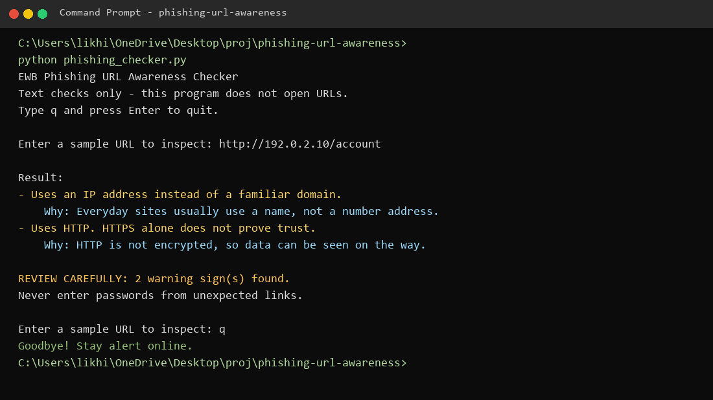
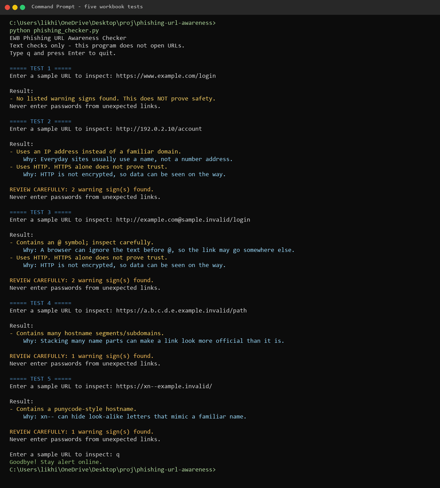

# EWB Phishing URL Awareness Checker

## Overview

Phishing is a trick that uses fake links or messages to steal passwords, card numbers, or OTPs. This project is a small command-line tool that reads a URL as text and looks for six visible warning signs. It never opens the link, never sends data anywhere, and never claims that a URL is safe.

## Features

- Detects an @ symbol in the URL
- Flags unusually long URLs (over 100 characters)
- Flags IP-address hostnames
- Flags many hostname segments (5 or more)
- Flags punycode-style hostnames (xn--)
- Flags the HTTP scheme
- Repeat checks in a loop until you type `q`
- Prints a **REVIEW CAREFULLY** summary when warning signs are found
- Handles malformed input instead of crashing
- Explains each warning in simple words

## Requirements

Python 3.10 or later. No extra packages.

## How to Run

Windows:

```
python phishing_checker.py
```

Mac/Linux:

```
python3 phishing_checker.py
```

When asked, type one of the sample URLs from `tests/test_samples.md`. Type `q`, `quit`, or `exit` to stop. Use sample strings only. Do not paste real suspicious links.

## Example Output

```
EWB Phishing URL Awareness Checker
Text checks only - this program does not open URLs.
Type q and press Enter to quit.

Enter a sample URL to inspect: http://192.0.2.10/account

Result:
- Uses an IP address instead of a familiar domain.
    Why: Everyday sites usually use a name, not a number address.
- Uses HTTP. HTTPS alone does not prove trust.
    Why: HTTP is not encrypted, so data can be seen on the way.

REVIEW CAREFULLY: 2 warning sign(s) found.
Never enter passwords from unexpected links.
```

## Testing

Five workbook samples were run on Python 3.14.3 (Windows). Full notes are in `tests/test_samples.md`.

| # | Input | Expected | Actual | Result |
|---|-------|----------|--------|--------|
| 1 | https://www.example.com/login | No warning signs | No listed warning signs found. This does NOT prove safety. | PASS |
| 2 | http://192.0.2.10/account | IP address + HTTP | IP hostname warning and HTTP warning | PASS |
| 3 | http://example.com@sample.invalid/login | @ symbol + HTTP | @ warning and HTTP warning | PASS |
| 4 | https://a.b.c.d.e.example.invalid/path | Many hostname segments | Many hostname segments/subdomains | PASS |
| 5 | https://xn--example.invalid/ | Punycode-style hostname | Punycode-style hostname | PASS |

## Screenshots




## Improvements

1. **Loop with quit** - `main()` keeps asking for URLs until you type `q`, `quit`, or `exit`. This avoids restarting the program for every test. I re-ran all five samples in one session.
2. **Review carefully summary** - if the result is a real warning (not an info message), the program prints how many warning signs were found. Checked with `http://192.0.2.10/account` (2 warnings) and the HTTPS example.com sample (no summary).
3. **Safer parsing** - `urlparse()` is wrapped in `try` / `except ValueError`, so text like `http://[bad` no longer crashes. It prints `This text is not a valid URL format.`
4. **Plain-English reasons** - each of the six warnings has a short "Why" line so a beginner can explain the clue without memorising jargon. The original warning text is unchanged so the workbook tests still match.

## Limitations

This is an educational tool. It only reads URL text. It does not visit URLs, scan for malware, or prove that a URL is safe. No warning signs found does NOT mean a URL is safe. A misspelled brand name, for example, would not be caught.

## Ethical Use

Use sample strings only. Do not collect credentials. Do not use this project to deceive anyone or to test websites without permission.

## Author

Likhi, EWB Courses (AI-Powered Cybersecurity)
